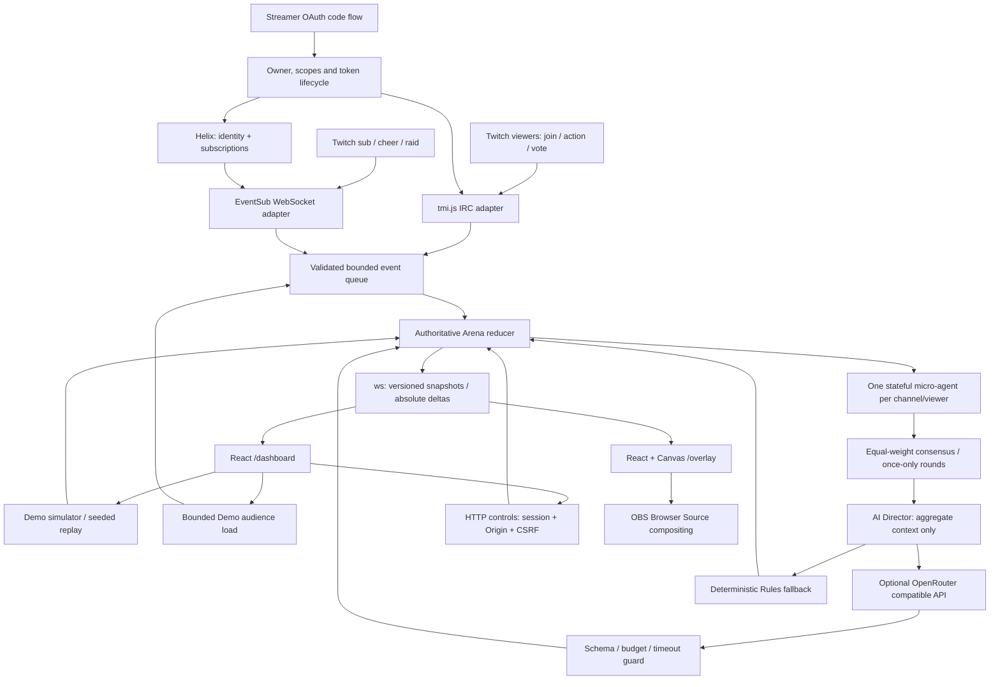

# TwitchHive

One micro-agent per Twitch viewer, coordinated into an interactive stream arena. Built for the approved Codex x TwitchCon project, with a React streamer command deck and a transparent Canvas OBS arena.

Official repository: [AgentAppStudio/twitchhive](https://github.com/AgentAppStudio/twitchhive). Released under the [MIT License](LICENSE).

Use **Hide simulator** for the two-column desktop Broadcast View, or **Show simulator** to restore the panel (mobile stays stacked). The disclosure supports Enter/Space and exposes its expanded state to assistive technology. Pause, Director rules, challenges, engagement counts and **Reset arena** remain available while Simulator is hidden; reset confirms the session impact and restores keyboard focus. Live mode automatically selects **Insights / Live telemetry**, with Demo event controls unavailable.

Codex CLI follow-up source `8fb7edd`: build, 24 unit/integration tests and 5 UI E2E tests passed, including reset while hidden and a fixture-based Live transition. See [fresh validation](VALIDATION.md#broadcast-view-follow-up--2026-10-31-local-time) and [evidence](docs/evidence/broadcast/verification.json). Primary session: `01a18b93-7177-7f81-8565-55d276f45250`; follow-up: `01a18eff-18fe-7b41-8b46-4eb6b1728eb7` (active CLI environment). Real Twitch/OBS verification remains pending.

## Run and verify

Requires Node.js 22+ and npm. No credentials required for Demo.

```sh
npm ci
npx playwright install chromium
npm run check
npm run dev
```

Open **http://127.0.0.1:3000/dashboard** (http://localhost:3000 also works). `npm run dev` starts Vite at port 3000 and backend at 3001, forwarding `/api`, `/auth`, `/ws` and `/healthz`. The default browser Origin is http://127.0.0.1:3000; the localhost alias is accepted only for same-port loopback development.

To run the production build locally:

```sh
npm run build
npm start
# http://127.0.0.1:3000/dashboard
```

Node serves the built frontend and HTTP/WebSocket API on port 3000. Local production-build preview does not require `NODE_ENV=production`; that variable enables hosted HTTPS enforcement. For real hosting set NODE_ENV=production and an HTTPS APP_ORIGIN, terminate TLS at a reverse proxy and preserve Origin/WS upgrades. Hosted Demo needs no provider credentials; hosted Live additionally requires STREAMER_CONTROL_TOKEN and TWITCH_CHANNEL. Disable proxy access-log query strings on OAuth callback and overlay WS paths. HTML uses COOP same-origin and COEP require-corp; all UI fonts/assets are self-hosted. This also enables high-resolution browser timing for the benchmark.

Copy `.env.example` to ignored `.env` for optional Twitch/OpenRouter setup; then `node --env-file=.env dist/server/index.js`. The default PORT in .env.example is 3000; `npm run dev` uses a dedicated backend port 3001. Never put private credentials in VITE_* variables.

## Two-minute judge path

1. Open `/dashboard` and choose **Start Demo**. No Twitch account or API key is needed.
2. Enter a viewer name and send `!join`, open a challenge, then send `!action shield` and `!vote chaos`. Each viewer has an independent role, energy and contribution.
3. Trigger Sub, Raid and Cheer. These are visibly labeled Demo events and create cosmetic effects, never real payments or extra votes.
4. Choose **Replay scenario** to seed 20 agents. Resolve a round, adjust difficulty and pause/resume. Rules fallback is explicit when no model is configured.
5. Choose **Open overlay** to see the same server state in a separate tab. **Copy OBS URL** gives a capability URL using a token in the fragment, so the HTML request does not carry it. The WS handshake uses a scoped read-only token.
6. In OBS add Browser Source, paste that URL, use **1920 × 1080**, and leave the background transparent. State survives dashboard reload; session restart/expiry clears memory. A copied URL expires after one hour; keep it private.

## Architecture



Only the reducer mutates game state. Simulator commands/replay enter its shared validation synchronously for immediate per-command acknowledgement; IRC, EventSub and the audience-load producer use the bounded queue before the same reducer. Agents are lightweight independent policy/state objects, not separate paid LLM requests. The Director's constrained proposal cannot override votes, pause or authorization. No external game/OS controls or Twitch Extension are used. Sessions, tokens, event queues and agent memory live in one Node process; no database is required.

## API contract for the frontend

1. `POST /api/demo` with `Origin: APP_ORIGIN` creates an isolated one-hour session. Store the HttpOnly session cookie; response contains `csrf`, `overlayToken`, mode and expiry. Each browser session owns an arena; no global Demo state. Repeating this endpoint with a valid session cookie reuses that session for reload recovery. It also returns safe booleans twitchConfigured/requiresOwnerToken.
2. `GET /api/session` with cookie returns authoritative state and per-adapter health. This endpoint never returns Twitch/AI credentials. Agent arrays and leaderboard are detached snapshots.
3. Control/simulator POSTs require cookie, matching `Origin` and `X-CSRF-Token`, JSON body, <=16KiB. Limit 30 mutations/minute/session. Dashboard must show status codes and reason, rather than assuming a request succeeded.

| Endpoint | JSON body | Result |
|---|---|---|
| `/api/control/challenge` | `{"action":"open"}` or `{"action":"close"}` | Start a 30-second round / resolve early |
| `/api/control/pause`, `/resume`, `/reset` | `{}` | Pause, resume, reset session epoch |
| `/api/control/rules` | `{"difficulty":2}` | Integer 1..5 |
| `/api/control/disconnect` | `{}` | Live owner disconnects, switches to clean Demo |
| `/api/simulator/events` | `{"kind":"chat","viewerId":"alice","text":"!join"}` | Normalized event through same reducer as Live |
| `/api/simulator/events` | `{"kind":"cheer","viewerId":"alice","count":100}` | `sub`, `raid`, `cheer`; cosmetic effects only |
| `/api/simulator/load` | `{"agents":500,"eventsPerSecond":50,"durationSec":300}` | Bounded Demo audience load; reset/replay invalidates it |
| `/api/simulator/replay` | `{"seed":42}` | Deterministic 20-viewer scenario with all command/event kinds |
| `/auth/twitch/start` | `{}` | Owner-gated OAuth URL; navigate browser to URL |

Valid commands: `!join` / `!hive`, `!action attack|shield|heal`, `!vote boss|chaos`. Actions cost 10 energy and have 2-second cooldown. Voting is one replaceable equal-weight vote per joined viewer per round; Bits/subs do not affect votes. Unjoined/invalid/stale/paused events return reasons without applying actions. Chat ordinary text is not persisted. Raid counts never manufacture viewer identities. One agent per channel/user ID; 500 active cap; 15-minute dormant entries may be evicted. All memory disappears on restart.

`GET /healthz` is a liveness probe, **not** proof of live Twitch connectivity. Errors: 400 malformed input; 401 session; 403 origin/CSRF/owner; 409 state/mode; 413 body size; 429 throttle; 503 unconfigured/unavailable service. Unknown routes return 404. `/api/control/connect` directs callers to the OAuth workflow.

### WebSocket

- `/ws/dashboard`: cookie and exact browser Origin required.
- `/ws/overlay?token=<overlayToken>`: scoped read-only session capability; works as OBS Browser Source backend. Twitch credentials never appear here. Treat the overlay token as a secret link; expires with session.
- Frames: `{v:1,type,sessionId,epoch,seq,payload}`. `snapshot` initially/every five seconds/on epoch change; `delta` at most 10Hz carries **absolute full current public state** in v1 (a valid replacement update, not numeric increments). Frontend can replace its state with payload. Discard older seq; session/epoch change or seq gaps require `{"type":"snapshot"}`.
- Both sockets are read-only: mutations go through HTTP control auth. Heartbeat every 15s; disconnect after 45s without pong. Buffered output >1MiB closes slow client, which must reconnect and consume a snapshot. The React client reconnects with 1–30s exponential backoff/jitter, freezes stale animation and requests a snapshot on sequence gaps.

Pause freezes deadlines, energy and effects; Director results arriving during pause wait for resume. Reset invalidates queued events and in-flight Director results. Consensus resolves once; boss wins ties/no-vote, independent of model's suggested scenario. Arena-only haste/slow modifies attack damage, shield prevents periodic enemy damage; effects expire within 15 seconds. No external game/OS tools exist.

## Real Twitch integration

Register a Twitch application and configure its redirect URL to match TWITCH_REDIRECT_URI exactly. Configure the client ID, secret and broadcaster login in ignored `.env`. The app uses server-side authorization code flow, anti-CSRF OAuth state (5-minute, single use), an HttpOnly SameSite=Lax cookie for the cross-site GET callback, owner identity validation, in-memory access/refresh tokens, refresh before expiry, and hourly validation. Hosted owner authorization also requires `Authorization: Bearer <STREAMER_CONTROL_TOKEN>` on `/auth/twitch/start`; do not expose that token to public Demo clients. Only one Live owner session is permitted per deployment.

OAuth scopes (checked against [official subscription types](https://dev.twitch.tv/docs/eventsub/eventsub-subscription-types/) and [Twitch OAuth](https://dev.twitch.tv/docs/authentication/getting-tokens-oauth/)):

| Consumer | Scope | Version / condition |
|---|---|---|
| tmi.js IRC read-only chat | `chat:read` | Stable IRC user/message IDs; no chat:edit |
| EventSub `channel.subscribe` | `channel:read:subscriptions` | v1, broadcaster_user_id |
| EventSub `channel.cheer` | `bits:read` | v1, broadcaster_user_id |
| EventSub `channel.raid` | No additional scope | v1, to_broadcaster_user_id |
| Helix `/users` | Valid user token | Resolves authenticated broadcaster identity |

EventSub is a **WebSocket user-token** transport. Subscriptions are created after welcome, reused during reconnect handoff, recreated after a fresh connection; keepalive expiry reconnects with backoff. Reconnect URLs are restricted to Twitch's EventSub host. Revocations clear credentials and disconnect adapters; health never silently switches to Demo. Helix retries 429 at most twice, honors reset headers, and refuses >30-second waits. No webhook signature path is needed.

Real smoke checklist (requires an authorized broadcaster, not run by fixture tests): connect; verify all three health states; send `!join` then `!action`/`!vote` during an open round from real chat; inspect agent and ordered WS output; receive a real supported sub/cheer/raid; disconnect/revoke and verify degraded health. Record revision, redacted timestamps and event IDs in VALIDATION.md. Tests never create real donations, subscriptions or raids. Fixture integration is not evidence of live access.

## AI Director and cost

Per Studio Harness CONVENTIONS-AI, inference uses [OpenRouter's OpenAI-compatible API](https://openrouter.ai/docs/api_reference/overview), configured only by OPENROUTER_API_KEY and OPENROUTER_MODEL. No hardcoded paid model, no automatic live calls in tests. Missing config, budget exhaustion, malformed response, HTTP error or 2-second timeout falls back to deterministic Rules with an explicit reason. One call per round, max 30 calls per Director/session, 512 output tokens, no retries. Only aggregate arena context goes to the provider; raw chat, identities and OAuth tokens are excluded. Schema-limited proposals never override consensus, pause or authorization. `BUSINESS_MODEL.md` documents the token cost envelope and benchmark approach.

## Testing and delivery status

Tests use fake clocks/seeded replay, real ephemeral HTTP/ws servers, actual tmi.js talking to a local IRC WebSocket fixture, Helix/OAuth fixtures and model HTTP fixtures. `npm run check` runs format lint, strict backend/client typecheck, all unit/integration tests, build and browser E2E. AC IDs appear in test names. CI runs the same checks. `docs/ISSUE_2_BACKEND.md` records the earlier backend handoff. Current acceptance and evidence are in `VALIDATION.md`; Devpost narrative and Codex Session ID are in `SUBMISSION.md`.

`npm run test:e2e` runs two-tab real-backend UI flows, keyboard/mobile, transparency and reconnect. `npm run test:performance` runs a five-minute wall-clock 500-agent / 50-events/s benchmark at 1920×1080 with browser timing instrumentation. Build before either command; Playwright starts the compiled server itself and fails if port 3000 is occupied. A shorter `HIVE_BENCH_SECONDS=10 npm run test:performance` is preflight only, not evidence for the full five-minute requirement. Browser binaries: pinned Playwright 1.56.1 + its installed Chromium; see VALIDATION for the actual tested version. Actual Twitch authorization, manual OBS compositing and an uploaded <3-minute demo video require the release owner; do not infer those from automated fixture results.
